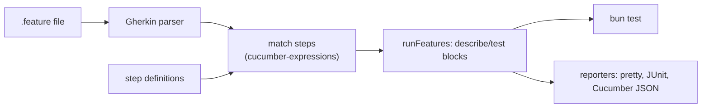

<div align="center">

# `@questi0nm4rk/feats`

**A BDD runner that turns Gherkin `.feature` files into `bun test` tests, for TypeScript projects on Bun.**

[](https://www.npmjs.com/package/@questi0nm4rk/feats)
[](https://github.com/Questi0nM4rk/feats/actions/workflows/check.yml)
[](https://github.com/Questi0nM4rk/feats/actions/workflows/check.yml)
[](./LICENSE)

</div>

```gherkin
Scenario: Add item and checkout
  Given the cart is empty
  When I add "Widget" to the cart
  Then the cart should have 1 item
```

```ts
import { Given, loadFeatures, runFeatures } from "@questi0nm4rk/feats";

Given("the cart is empty", (world) => { world.items = []; });

runFeatures(await loadFeatures("tests/features/*.feature"));
```

`bun test` then runs each scenario as a `bun:test` test.

## Why it exists

My other tools needed behaviour specs that a person can read, and `bun:test` alone keeps the spec in test names, not in Gherkin.
cucumber-js has its own runner on Node, so its results do not appear in `bun test`.
This package parses Gherkin with the official parser and turns each scenario into a `bun:test` test, so one command runs everything.
It refuses to be a full Cucumber port: no parallelism of its own, no plugin protocol, no report server.
It has no reason to exist if `bun test` reads `.feature` files natively.

## Quickstart

```sh
git clone https://github.com/Questi0nM4rk/feats.git && cd feats && bun install --frozen-lockfile
bun test
```

Expected output ends with `0 fail`.

The project tests itself with its own feature file: `tests/features/self-test.feature`.
To use it in another project, run `bun add @questi0nm4rk/feats` (see Status for the npm version).
Lint and typecheck: `bun run lint` and `bun run typecheck`.

## How it works



No part of it calls a model.
The parser and the expression matcher are the official `@cucumber/*` packages.
This repo adds the registry, the runner, hooks, tag filters, reporters, a `feats` CLI and a Bun plugin that loads `.feature` files as modules.
Used for tests by [hook-kit](https://github.com/Questi0nM4rk/hook-kit), [ai-guardrails](https://github.com/Questi0nM4rk/ai-guardrails), [tagen](https://github.com/Questi0nM4rk/tagen) and [vori](https://github.com/Questi0nM4rk/vori).
Guide: [docs/guide.md](./docs/guide.md).
API: [docs/api.md](./docs/api.md).

## Numbers

[](https://github.com/Questi0nM4rk/feats/actions/workflows/check.yml)

| What | How to measure |
| --- | --- |
| Tests | `bun test` |
| Test time | `time bun test` |
| Source size | `scc src tests` |
| Bundle size | `bun run build` |
| Parser bench | `bun run bench` (parser only) |

The bench does not measure the runner. Bench numbers vary between runs and do not compare across machines.

Commits include agent-authored work under my identity; design, orchestration and review are mine.

## Status

- **Works:** parsing, step matching, hooks, tag filters, `Rule:`, pending steps, reporters, the `feats` CLI, the Bun plugin for `.feature` imports. Covered by the tests above.
- **Tried and dropped:** nothing recorded in the repo. The non-goals are in [docs/plans/roadmap.md](./docs/plans/roadmap.md).
- **Known gaps:**
  - The repo has no git tags or GitHub release yet.
    A `v*` tag stages the version in the npm queue; a maintainer approves it on npmjs.com (2FA) before it is live.
    The package version in `package.json` is ahead of npm, so the newest features are not on npm.
  - Step arguments arrive as `unknown`, so steps narrow them by hand.
  - No `# language:` support.
  - The bench covers the parser only.
  - Single maintainer.

## License

MPL-2.0.

Releases published before 2026-10-12 remain available under MIT.
